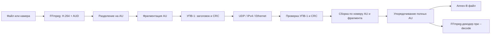

# Теория ЛР №2: H.264 access unit поверх UDP

Этот документ описывает текущую реализацию ЛР №2. Методичка требует передавать кодированный H.264 через собственный прикладной протокол УПВ-1, восстанавливать единицы доступа на приёмнике и не применять готовый видеотранспорт RTP/RTSP/SRT/WebRTC.

## Что именно передаётся

Видеокамера или файл даёт последовательность изображений. Кодировщик H.264 сжимает их в **битовый поток**. Поток состоит из NAL-единиц: среди них могут быть данные изображения, параметры декодирования SPS/PPS и вспомогательные данные. **Access unit (AU)** — набор NAL-единиц, относящихся к одному декодируемому изображению. В лабораторной работе удобнее передавать AU целиком как логический блок, даже если он занимает много UDP-датаграмм.

В GStreamer свойство `alignment=au` означает выдачу H.264 по границам AU. Здесь используется FFmpeg с `-x264-params aud=1`: кодировщик вставляет NAL типа AUD (*access unit delimiter*), а `iter_access_units()` разделяет поток по этим маркерам. Получается та же граница AU, хотя параметр GStreamer с буквальным именем `alignment=au` в программе не используется. NAL типа IDR помечает ключевой кадр; отправитель устанавливает для его пакетов признак `KEYFRAME`.

## Путь видеоданных

На отправителе FFmpeg читает вход и выдаёт H.264 Annex-B через stdout. Python читает stdout постепенно. `iter_access_units()` находит AUD; граница следующего AUD завершает предыдущую AU. Для AU длиной `L` байт `fragment()` создаёт `ceil(L / 1376)` пакетов. Каждому пакету назначаются общий номер AU, собственный сквозной номер пакета, индекс фрагмента и общее число фрагментов. Первый фрагмент получает `START`, последний — `END`. Один фрагмент может иметь оба признака.

Python отправляет каждый сформированный пакет через UDP. Сетевой маршрутизатор передаёт IP-пакеты между подсетями Orange Pi. UDP сохраняет границу датаграммы, но не гарантирует её доставку, порядок или отсутствие дубликатов.

На приёмнике `decode()` проверяет размер, идентификатор, версию, номера и CRC. Сборщик хранит фрагменты по `access_unit_id`; внутри AU располагает их по `fragment_index`. Только после получения всех фрагментов и признаков `START`/`END` он создаёт полную AU. Готовые AU выдаются по возрастанию номера. Если фрагмент потерян, неполная AU удаляется по тайм-ауту; после ожидания пропуска приёмник продолжает с ближайшей полной AU.

В режиме `--decode` приёмник пишет **только готовые AU** в stdin процесса FFmpeg (`-f h264 -i pipe:0 -f null -`). FFmpeg действительно декодирует поток, но текущая команда направляет результат в `null`: изображения на экран она не выводит. Те же AU сохраняются в `received.h264` для последующей проверки. Потеря AU может нарушить зависимости между H.264 кадрами до следующего IDR.

## Заголовок УПВ-1

Заголовок занимает **24 байта**; все многобайтовые числа передаются в сетевом порядке байт (*big-endian*).

| Смещение | Размер | Поле | Смысл |
|---:|---:|---|---|
| 0 | 2 | `magic = UP` | Отбрасывание посторонних датаграмм |
| 2 | 2 | `version_flags` | Старший байт — версия `1`, младший — признаки |
| 4 | 4 | `packet_id` | Сквозной номер пакета |
| 8 | 4 | `access_unit_id` | Номер AU, общий для её фрагментов |
| 12 | 2 | `fragment_index` | Номер фрагмента от `0` |
| 14 | 2 | `fragment_count` | Общее число фрагментов AU |
| 16 | 4 | `timestamp_ms` | Монотонная метка времени отправителя в мс по модулю `2³²` |
| 20 | 2 | `payload_length` | Число байт данных после заголовка |
| 22 | 2 | `crc16` | Контрольная сумма заголовка и данных |

Для видео признаки: `START = 0x01`, `END = 0x02`, `KEYFRAME = 0x04`. Файловый режим также использует `RELIABLE = 0x08`. Отдельный пакет подтверждения ACK имеет комбинацию `RELIABLE | KEYFRAME = 0x0C` и пустую полезную нагрузку; он не является видеокадром.

Контрольная сумма — **CRC-16/CCITT-FALSE** (полином `0x1021`, начальное значение `0xFFFF`, без отражения и финального XOR). Она считается по первым 22 байтам заголовка, затем по полезным данным; поле самой CRC в расчёт не входит. При изменении данных или защищённых полей заголовка пакет отбрасывается. CRC обнаруживает типичные случайные повреждения, но не заменяет криптографическую проверку подлинности.

## Размер пакета и отсутствие IPv4-фрагментации

По требованиям методички UDP-нагрузка вместе с заголовком УПВ-1 не превышает **1400 байт**. Поэтому максимум данных AU в одном пакете равен `1400 − 24 = 1376` байт. При обычных заголовках IPv4 20 байт и UDP 8 байт полный IP-пакет составляет максимум `20 + 8 + 1400 = 1428` байт. Это меньше Ethernet MTU 1500, поэтому при MTU 1500 фрагментация IPv4 не ожидается. Фактический MTU и отсутствие фрагментов нужно подтвердить захватом на стенде; расчёт не является результатом измерения.

## Видео и проверка файла

Видео идёт без подтверждений: ожидание повтора каждого потерянного пакета увеличило бы задержку. Если потерян хотя бы один фрагмент AU, неполная AU не попадает в декодер. Для проверки точности самого УПВ-1 применяется отдельный файловый режим: он отправляет по одному блоку, ждёт ACK и повторяет блок при тайм-ауте (*stop-and-wait ARQ*). Приёмник распознаёт повтор и не записывает его дважды. После передачи сравниваются SHA-256 исходного и восстановленного файла. SHA-256 проверяет весь результат, тогда как CRC-16 проверяет отдельную датаграмму.

## Где это в коде

| Этап | Модуль |
|---|---|
| Разделение H.264 по AUD и отправка | `src/labs/lab2/sender.py` |
| Упаковка, разбор, CRC и фрагментация УПВ-1 | `src/labs/lab2/protocol.py` |
| Накопление и упорядочивание AU | `src/labs/lab2/assembly.py` |
| UDP-приём, передача полных AU декодеру | `src/labs/lab2/receiver.py` |
| Надёжная передача файла для SHA-256 | `src/labs/lab2/filecheck.py` |

Оставшиеся стендовые испытания и ограничения перечислены в [TASKS.md](TASKS.md).
